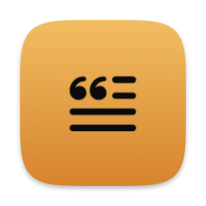
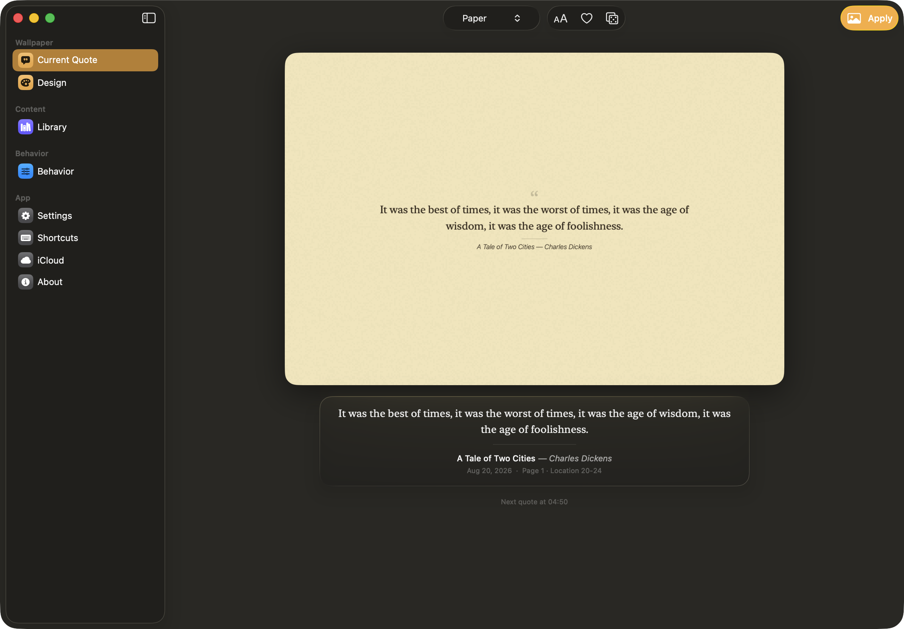
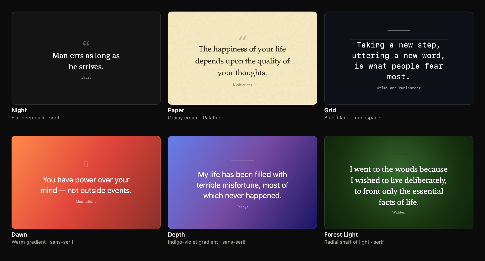
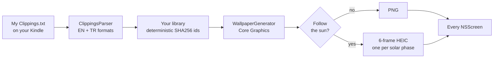

<div align="center">



<h1 align="center">KindleWall</h1>

**Your Kindle highlights, on your desktop.**

Point KindleWall at your Kindle's `My Clippings.txt` and it renders one passage from your own
library onto every display, rotating on a schedule you choose.

<a href="https://github.com/bekircem/KindleWall/releases/latest"></a>
<a href="https://github.com/bekircem/KindleWall/releases"></a>
<a href="https://www.apple.com/macos/"></a>
<a href="https://www.swift.org"></a>
<a href="https://github.com/bekircem/homebrew-tap"></a>
<a href="LICENSE"></a>

<br>

**[Website](https://bekircem.github.io/KindleWall/)** ·
[Install](#install) ·
[Styles](#the-six-styles) ·
[Features](#what-it-does) ·
[How it works](#how-it-works) ·
[Privacy](#privacy) ·
[Build](#build-from-source)

<br>



</div>

---

KindleWall is a free, open-source macOS app. There is no account, no server, and no telemetry.
It reads a text file your Kindle already writes, and it puts what you underlined back in front
of you — on the one screen you are guaranteed to look at every day.

**You do not need a Kindle to try it.** The app ships with a set of public-domain passages, so
you can load a library, pick a style and end up with a real wallpaper a minute after opening it.

Available in **English and Turkish**. The app follows your system language, and macOS lets you
give it a language of its own under System Settings → General → Language & Region → Applications.

<details>
<summary><b>Contents</b></summary>

- [Install](#install)
- [The six styles](#the-six-styles)
- [What it does](#what-it-does)
- [How it works](#how-it-works)
- [Requirements](#requirements)
- [Privacy](#privacy)
- [Build from source](#build-from-source)
- [Contributing](#contributing)
- [License](#license)
- [Trademark](#trademark)

</details>

## Install

### Homebrew

```sh
brew tap bekircem/tap
brew trust bekircem/tap
brew install --cask kindlewall
```

> [!NOTE]
> `brew trust` is not usually part of a cask install. Homebrew 6 requires it once per
> third-party tap before it will run the tap's formulae.

Upgrade later with `brew upgrade --cask kindlewall`, or let the app update itself.

### Signed DMG

Take the latest `KindleWall-X.Y.Z.dmg` from
**[Releases](https://github.com/bekircem/KindleWall/releases/latest)**, open it, and drag
**KindleWall** to **Applications**.

Every release is signed with a Developer ID, notarized by Apple, and stapled, so you should not
need to click past Gatekeeper. Updates arrive in-app through Sparkle, with EdDSA-signed appcast
entries.

> [!IMPORTANT]
> KindleWall requires **macOS 26 (Tahoe) or later**. It is not sandboxed, because
> `NSWorkspace`'s wallpaper API does not work inside the sandbox — file access uses
> security-scoped bookmarks instead.

### First run

KindleWall needs some highlights to render, and there are two ways to give it some:

| | |
|---|---|
| **You have a Kindle** | Plug it in, hit **Choose File…**, and pick `documents/My Clippings.txt` from the mounted volume — or drag that file straight onto the window. |
| **You don't** | Hit **No Kindle — Try the Samples**. Eight passages from eight public-domain books — Dostoyevsky, Melville, Dickens, Austen, Thoreau, Marcus Aurelius, Goethe, Montaigne — in whichever language the app is running in. |

Then pick a style and hit **Apply**. Your previous wallpaper is remembered, so *Settings →
Restore Previous Wallpaper* puts it back. Set a rotation interval under **Behavior** and
KindleWall takes it from there.

> [!NOTE]
> The samples are ordinary clippings once loaded. Importing your real `My Clippings.txt` later
> **adds to** them rather than replacing them, and you can delete them one at a time from the
> **Library** once you no longer want them.

> [!TIP]
> Your Kindle keeps appending to that file as you read. **Settings → Behavior → Source File →
> Check for New Highlights** re-reads the copy already on record and tells you what it found —
> how many new highlights, across how many books — without walking through the file picker again.

## The six styles

Each style differs on four axes — surface, value, temperature and typographic character — and
carries its own default font and decoration, so picking one is a visible change rather than a
different shade of grey.



> These tiles are drawn by [`scripts/make-style-strip.swift`](scripts/make-style-strip.swift)
> from the app's own colours and passages from [`SampleData/`](SampleData), not screenshotted —
> a screenshot of the real app would show somebody's actual reading history.

You can override the font, size, decoration and background colours afterwards. The style is a
starting character, not a lock.

## What it does

| Feature | What it does |
|---|---|
| **Reads highlights** | Parses `My Clippings.txt` in both the English and Turkish Kindle formats, deduplicates by content, and drops bookmarks and notes. Re-importing is incremental — favorites and shown-state survive. |
| **Fits the type** | Font size is chosen between 18 and 48 pt so the whole quote fits. Nothing is clipped to a fixed box. |
| **Follows the sun** | Optionally writes a multi-frame HEIC whose colour temperature tracks the solar position for your location, so the same passage warms at sunrise and cools after dark. macOS interpolates between the frames itself. |
| **Rotates** | Every book, one book at a time, only pinned books, or only favourites — every 30 minutes through to daily, or a custom interval. Shuffles without repeating until the pool is exhausted. |
| **Captures anywhere** | Select text in any app and press <kbd>⌃</kbd> <kbd>⌥</kbd> <kbd>K</kbd>, or use the Services menu, to turn it into a clipping. |
| **Finds covers** | The library screen fetches cover art from Google Books, falling back to Open Library. No API key. |
| **Menu bar** | Closing the window does not quit the app. |
| **Syncs your Macs** | Through your own private iCloud database — optional, off unless you are signed into iCloud, with last-write-wins conflict resolution and recovery from a deleted zone. |
| **Self-updating** | Sparkle, with EdDSA-signed releases. |

## How it works



The id of a highlight is a SHA256 UUID of its book title and text — page and location are
deliberately excluded, because Kindle reformats them. That is what lets favorites and
shown-state survive a re-import.

## Requirements

| Requirement | Details |
|---|---|
| **macOS** | 26 (Tahoe) or later |
| **Architecture** | Apple Silicon and Intel |
| **Kindle** | Any device or app that writes `My Clippings.txt` — English or Turkish |
| **Account** | None. iCloud is optional, and only used if you are already signed in. |

## Privacy

There is no analytics, no telemetry, and no server operated by this project. Precisely what
does and does not leave your Mac:

| What | Where it goes |
|---|---|
| Your highlights | Nowhere — unless you are signed into iCloud, in which case **your own** private CloudKit database, and nowhere else |
| **Book titles** | Google Books and Open Library, as search queries, when the library screen fetches cover art |
| Update checks | GitHub, to read the appcast |

> [!WARNING]
> The cover lookup is worth stating plainly: opening the library sends the titles of your books
> to two third-party services. Nothing else about you is attached, but the titles themselves say
> something about what you read.

## Build from source

```sh
brew install xcodegen
xcodegen generate
xcodebuild -project KindleWall.xcodeproj -scheme KindleWall -configuration Debug build
```

`project.yml` is the source of truth — `KindleWall.xcodeproj` is generated, so run
`xcodegen generate` after adding or removing a file, and never commit project edits made in
Xcode's UI.

<details>
<summary><b>Running the tests</b> — two steps, on purpose</summary>

<br>

The single-step `xcodebuild test` does not stage the xctest bundle. It dies with *"Failed to
create a bundle instance representing … KindleWallTests.xctest"*, which reads like a test
failure but means the tests never ran:

```sh
xcodebuild -project KindleWall.xcodeproj -scheme KindleWall clean
xcodebuild build-for-testing    -project KindleWall.xcodeproj -scheme KindleWall -destination 'platform=macOS,arch=arm64'
xcodebuild test-without-building -project KindleWall.xcodeproj -scheme KindleWall -destination 'platform=macOS,arch=arm64'
```

Always read the `Executed N tests` line before believing a result. Warnings live in the *build*
log, not the test log — `test-without-building` recompiles nothing, so grepping its output for
warnings always returns zero.

</details>

<details>
<summary><b>Architecture</b> — MVVM, protocol-injected services, Swift 6 strict concurrency</summary>

<br>

Every service is a protocol plus one concrete implementation, so view models take the protocol
in `init` and tests never touch the disk, the network, or your desktop. The app is built in
**Swift 6 language mode** with `SWIFT_STRICT_CONCURRENCY: complete`, so isolation violations are
compile errors rather than warnings; the render path stays off the main actor via detached tasks
that capture Sendable services.

`CLAUDE.md` in this repository documents the layout, the services, and the conventions in full.

</details>

<details>
<summary><b>Localization</b> — English source, Turkish translation</summary>

<br>

```sh
python3 scripts/sync-catalog.py          # rebuild the catalog from compiler .stringsdata
python3 scripts/sync-catalog.py --check  # CI-style check; run before opening a PR
```

Xcode only fills the String Catalog inside the IDE, and `xcstringstool sync` flags stale keys
but never adds new ones — hence the script.

An enum raw value stored in UserDefaults is a **storage key, not display text**. Translating one
silently resets that preference for everyone who had it set, so `RotationMode`,
`ScheduleInterval` and `WallpaperStyle` carry separate `displayName` properties and their raw
values are pinned by a test.

</details>

## Contributing

Bug reports are the most useful thing you can send — use the
[bug report form](https://github.com/bekircem/KindleWall/issues/new?template=bug_report.yml),
which asks for the app version, the macOS version and how you installed it, because those three
answers decide whether a bug can be reproduced at all.

Parsing bugs are nearly always about one specific entry, so include it from `My Clippings.txt`
between its `==========` separators. Redact whatever you like; the shape of the entry matters
more than its words.

Feature work is welcome, but open an issue first — this is a small app with a deliberately
narrow scope. Full guide: **[CONTRIBUTING.md](CONTRIBUTING.md)**.

## License

[GPL-3.0](LICENSE)

## Trademark

KindleWall is not affiliated with, endorsed by, or sponsored by Amazon.
Kindle is a registered trademark of Amazon.com, Inc.

---

<div align="center">

[Website](https://bekircem.github.io/KindleWall/) ·
[Releases](https://github.com/bekircem/KindleWall/releases) ·
[Issues](https://github.com/bekircem/KindleWall/issues) ·
🇹🇷 **[Türkçe README](README.tr.md)**

<sub>Built by <a href="https://github.com/bekircem">bekircem</a>. If KindleWall put a good line
in front of you today, a ⭐ helps somebody else find it.</sub>

</div>
