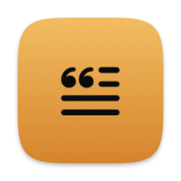
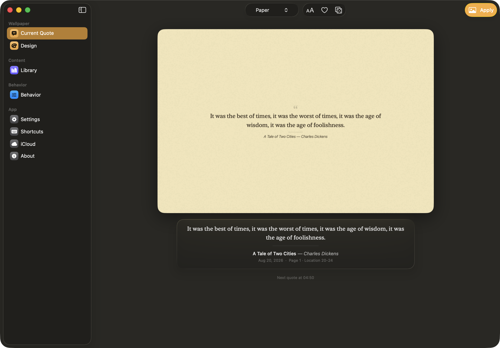
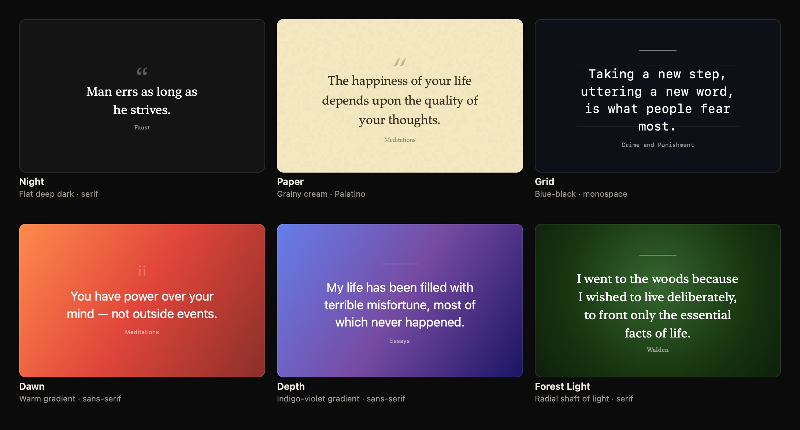
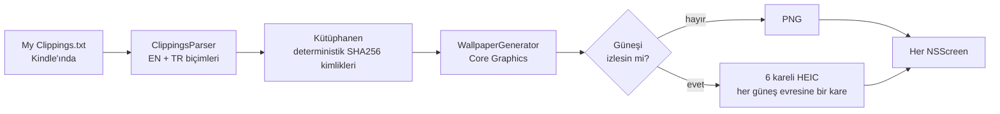

<div align="center">



<h1 align="center">KindleWall</h1>

**Kindle alıntıların, masaüstünde.**

KindleWall'a Kindle'ındaki `My Clippings.txt` dosyasını göster; kendi kütüphanenden bir pasajı
bütün ekranlarına basar ve senin belirlediğin aralıkla değiştirir.

<a href="https://github.com/bekircem/KindleWall/releases/latest"></a>
<a href="https://github.com/bekircem/KindleWall/releases"></a>
<a href="https://www.apple.com/tr/macos/"></a>
<a href="https://www.swift.org"></a>
<a href="https://github.com/bekircem/homebrew-tap"></a>
<a href="LICENSE"></a>

<br>

**[Web sitesi](https://bekircem.github.io/KindleWall/)** ·
[Kurulum](#kurulum) ·
[Stiller](#alti-stil) ·
[Özellikler](#ne-yapar) ·
[Nasıl çalışır](#nasil-calisir) ·
[Gizlilik](#gizlilik) ·
[Derleme](#kaynaktan-derleme)

<br>



</div>

---

KindleWall ücretsiz ve açık kaynak bir macOS uygulaması. Hesap yok, sunucu yok, telemetri yok.
Kindle'ının zaten yazdığı bir metin dosyasını okur ve altını çizdiğin satırları önüne geri
koyar — her gün baktığın kesin olan tek ekrana.

**Denemek için Kindle'a ihtiyacın yok.** Uygulama kamu malı bir pasaj setiyle geliyor; açtıktan
bir dakika sonra bir kütüphane yükleyip stil seçebilir ve gerçek bir duvar kağıdı elde edebilirsin.

**İngilizce ve Türkçe** kullanılabilir. Uygulama sistem dilini izler; istersen macOS'un
Sistem Ayarları → Genel → Dil ve Bölge → Uygulamalar bölümünden ona ayrı bir dil atayabilirsin.

<details>
<summary><b>İçindekiler</b></summary>

- [Kurulum](#kurulum)
- [Altı stil](#alti-stil)
- [Ne yapar](#ne-yapar)
- [Nasıl çalışır](#nasil-calisir)
- [Gereksinimler](#gereksinimler)
- [Gizlilik](#gizlilik)
- [Kaynaktan derleme](#kaynaktan-derleme)
- [Katkı](#katki)
- [Lisans](#lisans)
- [Marka](#marka)

</details>

<a id="kurulum"></a>

## Kurulum

### Homebrew

```sh
brew tap bekircem/tap
brew trust bekircem/tap
brew install --cask kindlewall
```

> [!NOTE]
> `brew trust` normalde cask kurulumunun bir parçası değildir. Homebrew 6, üçüncü taraf bir
> tap'in formüllerini çalıştırmadan önce bunu tap başına bir kez ister.

Sonradan `brew upgrade --cask kindlewall` ile yükselt, ya da uygulamanın kendini güncellemesine
bırak.

### İmzalı DMG

En son `KindleWall-X.Y.Z.dmg` dosyasını
**[Releases](https://github.com/bekircem/KindleWall/releases/latest)** sayfasından indir, aç ve
**KindleWall**'ı **Applications** klasörüne sürükle.

Her sürüm Developer ID ile imzalanır, Apple tarafından notarize edilir ve staple edilir; yani
Gatekeeper'ı atlatmaya uğraşman gerekmez. Güncellemeler uygulama içinde Sparkle üzerinden,
EdDSA imzalı appcast girdileriyle gelir.

> [!IMPORTANT]
> KindleWall **macOS 26 (Tahoe) veya üstünü** gerektirir. Sandbox kapalıdır, çünkü
> `NSWorkspace`'in duvar kağıdı API'si sandbox içinde çalışmaz — dosya erişimi bunun yerine
> security-scoped bookmark'larla yapılır.

### İlk açılış

KindleWall'ın basacak alıntılara ihtiyacı var; bunu vermenin iki yolu var:

| | |
|---|---|
| **Kindle'ın var** | Tak, **Dosya Seç…**'e bas ve bağlanan birimden `documents/My Clippings.txt` dosyasını seç — ya da o dosyayı doğrudan pencereye sürükle. |
| **Yok** | **Kindle'ım Yok, Örneklerle Dene**'ye bas. Sekiz kamu malı kitaptan sekiz pasaj — Dostoyevski, Melville, Dickens, Austen, Thoreau, Marcus Aurelius, Goethe, Montaigne — uygulama hangi dilde çalışıyorsa o dilde. |

Sonra bir stil seç ve **Uygula**'ya bas. Önceki duvar kağıdın hatırlanır; *Ayarlar → Önceki
Duvar Kağıdına Dön* onu geri koyar. **Davranış** altından bir döngü aralığı belirle, gerisini
KindleWall halleder.

> [!NOTE]
> Örnekler yüklendikten sonra sıradan birer alıntıdır. Kendi `My Clippings.txt` dosyanı
> sonradan içe aktarmak onların **üzerine ekler**, yerlerini almaz; istemediğinde
> **Kütüphane**'den tek tek silebilirsin.

> [!TIP]
> Kindle sen okudukça o dosyaya eklemeye devam eder. **Ayarlar → Davranış → Kaynak Dosya →
> Yeni Alıntıları Denetle**, kayıtlı kopyayı yeniden okur ve ne bulduğunu söyler — kaç yeni
> alıntı, kaç kitapta — dosya seçiciden tekrar geçmene gerek kalmadan.

<a id="alti-stil"></a>

## Altı stil

Her stil dört eksende ayrışır — yüzey, değer, sıcaklık ve tipografik karakter — ve kendi
varsayılan yazı tipini ve süslemesini taşır; yani stil seçmek gri tonu değiştirmek değil,
görünür bir değişiklik.



> Bu kareler ekran görüntüsü değil: [`scripts/make-style-strip.swift`](scripts/make-style-strip.swift)
> tarafından uygulamanın kendi renkleriyle ve [`SampleData/`](SampleData) içindeki pasajlarla
> çiziliyor — gerçek uygulamanın ekran görüntüsü birinin gerçek okuma geçmişini gösterirdi.

Yazı tipini, punto, süsleme ve arka plan renklerini sonradan istediğin gibi değiştirebilirsin.
Stil bir başlangıç karakteridir, bir kilit değil.

<a id="ne-yapar"></a>

## Ne yapar

| Özellik | Ne yapar |
|---|---|
| **Alıntıları okur** | `My Clippings.txt` dosyasını hem İngilizce hem Türkçe Kindle biçiminde ayrıştırır, içeriğe göre yinelenenleri ayıklar, yer imlerini ve notları eler. Yeniden içe aktarma artımlıdır — favoriler ve gösterilme durumu korunur. |
| **Puntoyu ayarlar** | Punto, alıntının tamamı sığsın diye 18 ile 48 pt arasında seçilir. Hiçbir şey sabit bir kutuya sığdırılıp kırpılmaz. |
| **Güneşi izler** | İstersen renk sıcaklığı bulunduğun konumdaki güneş konumunu takip eden çok kareli bir HEIC yazar; aynı pasaj gündoğumunda ısınır, karanlık bastıktan sonra soğur. Kareler arasını macOS kendisi yumuşatır. |
| **Döngü** | Tüm kitaplar, kitap kitap, yalnızca sabitlenenler ya da yalnızca favoriler — 30 dakikadan günlüğe, ya da özel bir aralık. Havuz tükenene kadar tekrarsız karıştırır. |
| **Her yerden yakalar** | Herhangi bir uygulamada metni seç ve <kbd>⌃</kbd> <kbd>⌥</kbd> <kbd>K</kbd>'ye bas, ya da Servisler menüsünü kullan; seçtiğin metin alıntıya döner. |
| **Kapak bulur** | Kütüphane ekranı kapak görselini Google Books'tan, olmazsa Open Library'den çeker. API anahtarı gerekmez. |
| **Menü çubuğu** | Pencereyi kapatmak uygulamayı kapatmaz. |
| **Mac'ler arası eşitleme** | Kendi özel iCloud veritabanın üzerinden — isteğe bağlı, iCloud'a giriş yapmadıysan kapalı; son-yazan-kazanır çakışma çözümü ve silinmiş zone'dan kendiliğinden toparlanma ile. |
| **Kendini günceller** | Sparkle ile, EdDSA imzalı sürümler. |

<a id="nasil-calisir"></a>

## Nasıl çalışır



Bir alıntının kimliği, kitap adı ile metninin SHA256 UUID'sidir — sayfa ve konum bilerek dışarıda
bırakılır, çünkü Kindle onları yeniden biçimlendirir. Favorilerin ve gösterilme durumunun yeniden
içe aktarmada hayatta kalmasını sağlayan şey budur.

<a id="gereksinimler"></a>

## Gereksinimler

| Gereksinim | Ayrıntı |
|---|---|
| **macOS** | 26 (Tahoe) veya üstü |
| **Mimari** | Apple Silicon ve Intel |
| **Kindle** | `My Clippings.txt` yazan her cihaz veya uygulama — İngilizce ya da Türkçe |
| **Hesap** | Yok. iCloud isteğe bağlıdır ve yalnızca zaten giriş yapmışsan kullanılır. |

<a id="gizlilik"></a>

## Gizlilik

Analitik yok, telemetri yok, bu projenin işlettiği bir sunucu yok. Mac'inden neyin çıkıp
neyin çıkmadığı tam olarak şöyle:

| Ne | Nereye gider |
|---|---|
| Alıntıların | Hiçbir yere — iCloud'a giriş yaptıysan **kendi** özel CloudKit veritabanına, başka hiçbir yere |
| **Kitap adların** | Kütüphane ekranı kapak görseli ararken, arama sorgusu olarak Google Books ve Open Library'ye |
| Güncelleme denetimi | Appcast'i okumak için GitHub'a |

> [!WARNING]
> Kapak araması açıkça söylenmeyi hak ediyor: kütüphaneyi açmak kitaplarının adlarını iki üçüncü
> taraf servise gönderir. Yanına senin hakkında başka hiçbir şey eklenmez, ama adların kendisi ne
> okuduğun hakkında bir şey söyler.

<a id="kaynaktan-derleme"></a>

## Kaynaktan derleme

```sh
brew install xcodegen
xcodegen generate
xcodebuild -project KindleWall.xcodeproj -scheme KindleWall -configuration Debug build
```

`project.yml` tek doğruluk kaynağıdır — `KindleWall.xcodeproj` üretilir; dosya ekleyip
sildikten sonra `xcodegen generate` çalıştır ve Xcode arayüzünde yapılan proje düzenlemelerini
asla commit'leme.

<details>
<summary><b>Testleri koşmak</b> — bilerek iki adım</summary>

<br>

Tek adımlı `xcodebuild test`, xctest paketini hazırlamaz. *"Failed to create a bundle instance
representing … KindleWallTests.xctest"* diye ölür; bu bir test başarısızlığı gibi okunur ama
testlerin hiç koşmadığı anlamına gelir:

```sh
xcodebuild -project KindleWall.xcodeproj -scheme KindleWall clean
xcodebuild build-for-testing     -project KindleWall.xcodeproj -scheme KindleWall -destination 'platform=macOS,arch=arm64'
xcodebuild test-without-building -project KindleWall.xcodeproj -scheme KindleWall -destination 'platform=macOS,arch=arm64'
```

Bir sonuca inanmadan önce her zaman `Executed N tests` satırını oku. Uyarılar *build* log'unda
yaşar, test log'unda değil — `test-without-building` hiçbir şeyi yeniden derlemez, dolayısıyla
çıktısında uyarı aramak her zaman sıfır döndürür.

</details>

<details>
<summary><b>Mimari</b> — MVVM, protokolle enjekte edilen servisler, Swift 6 katı eşzamanlılık</summary>

<br>

Her servis bir protokol artı tek bir somut uygulamadır; view model'ler `init`'te protokolü alır,
böylece testler diske, ağa ya da masaüstüne hiç dokunmaz. Uygulama **Swift 6 dil kipinde** ve
`SWIFT_STRICT_CONCURRENCY: complete` ile derlenir; izolasyon ihlalleri uyarı değil derleme
hatasıdır. Render yolu, Sendable servisleri yakalayan detached task'ler sayesinde ana aktörün
dışında kalır.

Bu depodaki `CLAUDE.md`, yerleşimi, servisleri ve kuralları eksiksiz belgeliyor.

</details>

<details>
<summary><b>Lokalizasyon</b> — İngilizce kaynak, Türkçe çeviri</summary>

<br>

```sh
python3 scripts/sync-catalog.py          # kataloğu derleyicinin .stringsdata çıktısından kur
python3 scripts/sync-catalog.py --check  # CI tarzı denetim; PR açmadan önce çalıştır
```

Xcode String Catalog'u yalnızca IDE içinde doldurur ve `xcstringstool sync` bayat anahtarları
işaretler ama yenilerini asla eklemez — betiğin sebebi bu.

UserDefaults'ta saklanan bir enum ham değeri **görüntü metni değil, depolama anahtarıdır**.
Birini çevirmek, o tercihi ayarlamış olan herkes için sessizce sıfırlar; bu yüzden
`RotationMode`, `ScheduleInterval` ve `WallpaperStyle` ayrı `displayName` özellikleri taşır ve
ham değerleri bir testle sabitlenmiştir.

</details>

<a id="katki"></a>

## Katkı

Gönderebileceğin en yararlı şey hata bildirimidir —
[hata bildirim formunu](https://github.com/bekircem/KindleWall/issues/new?template=bug_report.yml)
kullan. Uygulama sürümünü, macOS sürümünü ve nasıl kurduğunu sorar; çünkü bir hatanın yeniden
üretilip üretilemeyeceğine bu üç yanıt karar verir.

Ayrıştırma hataları neredeyse her zaman tek bir girdiyle ilgilidir; o girdiyi
`My Clippings.txt` içinden `==========` ayraçlarıyla birlikte ekle. İstediğin yeri karart;
girdinin şekli sözcüklerinden daha önemli.

Özellik katkısı da hoş karşılanır, ama önce bir issue aç — burası kapsamı bilerek dar tutulmuş
küçük bir uygulama. Tam kılavuz: **[CONTRIBUTING.md](CONTRIBUTING.md)**.

<a id="lisans"></a>

## Lisans

[GPL-3.0](LICENSE)

<a id="marka"></a>

## Marka

KindleWall'ın Amazon ile bir bağlantısı yoktur; Amazon tarafından desteklenmez veya
onaylanmaz. Kindle, Amazon.com, Inc. şirketinin tescilli markasıdır.

---

<div align="center">

[Web sitesi](https://bekircem.github.io/KindleWall/) ·
[Sürümler](https://github.com/bekircem/KindleWall/releases) ·
[Issue'lar](https://github.com/bekircem/KindleWall/issues) ·
🇬🇧 **[English README](README.md)**

<sub><a href="https://github.com/bekircem">bekircem</a> tarafından yapıldı. KindleWall bugün
önüne iyi bir satır koyduysa, bir ⭐ başkasının da onu bulmasına yardım eder.</sub>

</div>
